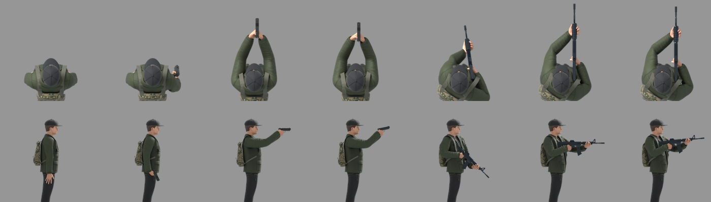
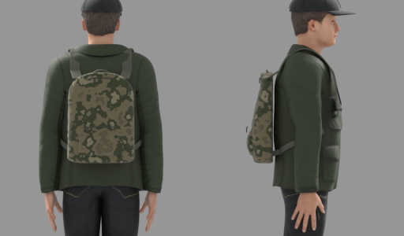
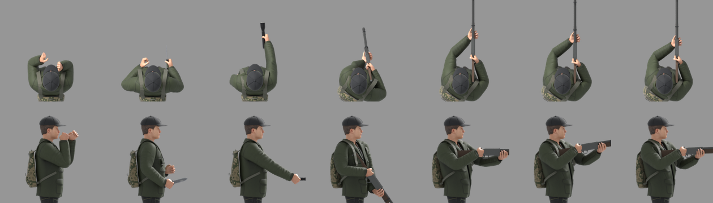
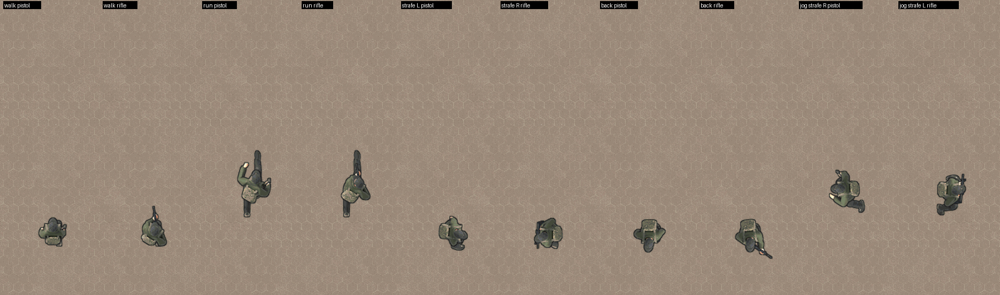
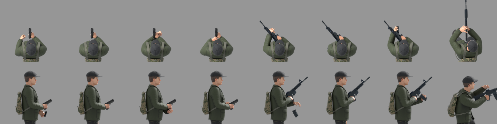
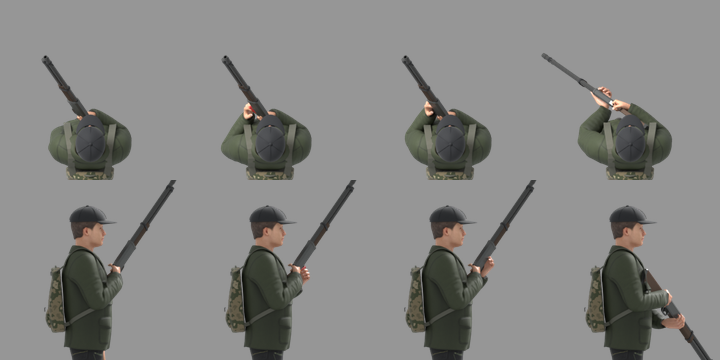
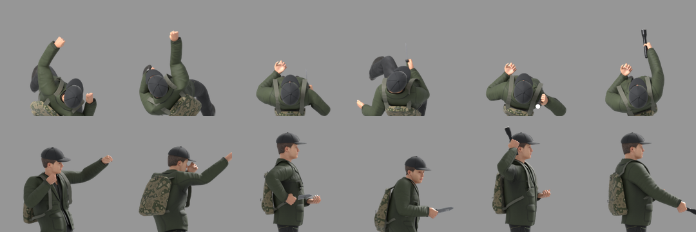
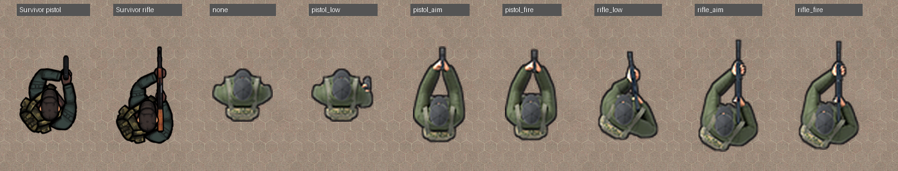

# CJ-011 player art

The player becomes a 3D character rendered from above with the [civilian 3D pipeline](../cj004/README.md#civilian-3d-pipeline), replacing the Survivor sprites, so that it walks and runs with the weapon lowered and raises it only to aim and fire ([CJ-011](../../../docs/backlog.md#cj-011-relaxed-player-posture)). This document records the player's look, the weapon holds, the layered gaits, the reloads and melee attacks, the scripts that make them, the game's atlases and their measurements. Since 2026-10-11 the game draws the player from these renders.

## Contents

- [Sources](#sources)
- [Look](#look)
- [Weapon holds](#weapon-holds)
- [Layers and gaits](#layers-and-gaits)
- [Reloads and melee](#reloads-and-melee)
- [Scripts](#scripts)
- [Atlases](#atlases)
- [Measurements](#measurements)
- [Open items](#open-items)

## Sources

| Part | Source | Licence |
|---|---|---|
| Body, clothes, hair, skin | MakeHuman asset packs, as the civilians ([CREDITS](../../../CREDITS.md)) | CC0 |
| Weapons | [Ultimate Gun Pack](https://opengameart.org/content/low-poly-guns-pack) by Quaternius: `Pistol_1`, `AssaultRifle2_1` (an M4-style carbine), `Shotgun_2` (a wooden pump shotgun) and the `Bayonet_2` combat knife, chosen by the user on 2026-10-10; the rifle's magazine is separated from its model for the reloads | CC0 |
| Flashlight, pistol magazine, shotgun shell | Modelled by script ([build_player.py](../../../tools/cj011/build_player.py), [render_player.py](../../../tools/cj011/render_player.py)): a 0.30 m black police flashlight, a steel magazine, a red 12-gauge shell with a brass head | This project |
| Walk, run, punches | [Universal Animation Library](https://quaternius.com/packs/universalanimationlibrary.html) by Quaternius: `Walk_Formal_Loop`, `Sprint_Loop`, `Punch_Jab` and `Punch_Cross`, as the civilians | CC0 |
| Strafes, backpedal, rifle charging, stab | [Mixamo](https://www.mixamo.com/) by Adobe: `Walk Strafe Left` and `Right`, `Jog Strafe Left` and `Right`, `Walking Backwards`, `Reloading 2 handed gun`, `Stabbing` (In Place, 30 fps, without skin), downloaded by the user on 2026-10-10 | Mixamo terms: free to use in projects; the animation files are not redistributed |

The Universal Animation Library and its second volume contain no strafe or backpedal. Two first-person arm animations the user downloaded from Sketchfab (a pistol and a shotgun) served only as references for how the hands work a reload; nothing of them is used. Downloads stay in `build/art-sources/` (ignored by Git): the gun pack in `downloads/`, its OBJ files in `guns/`, the Mixamo files in `mixamo/`.

## Look

The player keeps the Survivor's look, so that it stays recognisable and stands out from the civilians: a 1.80 m man in a dark baseball cap, an olive green jacket over a dark shirt, dark trousers and dark ankle boots, with a camouflage backpack.



| Part | Made by |
|---|---|
| Jacket, shirt and trousers | MakeHuman `male_casualsuit05`, its texture recoloured by [player_texture.py](../../../tools/cj011/player_texture.py): the jacket olive green, every island of the striped shirt a plain dark shirt, the denim dark charcoal |
| Boots | MakeHuman `toigo_ankle_boots_male`, darkened |
| Cap | Modelled by [build_player.py](../../../tools/cj011/build_player.py): a crown fitted over the head and hair, six faint seams, a button and a curved peak, fixed to the head bone |
| Backpack | Modelled by the same script: a soft daypack 0.30 m wide, 0.10 m deep and 0.42 m tall with rounded top corners, fuller low than high, its fabric wrinkled by a displacement and woven by a bump texture; a zip round the top, a front pocket with a zip, a grab handle; flat padded shoulder straps laid on the jacket to a buckle on the chest, and narrow lower straps from the buckle round the side to the pack's bottom corners; khaki, tan, olive, sand and brown camouflage. Fixed to `spine_03` |

The user's corrections on 2026-10-10: no striped shirt; the shoulder straps lie flat on the body instead of standing on edge; a flatter pack; a fabric pack with lower straps, not a rounded box; darker camouflage instead of a whitish one; a darker cap with fainter seams.



## Weapon holds

A weapon is placed in the rig's space and the hands are put on it by a two-bone inverse kinematics solved in [render_player.py](../../../tools/cj011/render_player.py): the palm on the grip (the right hand) or on the fore grip (the left), the hand turned to hold it, the elbow towards a pole. The elbow is a hinge: the upper arm turns so that the arm bends in its rest plane, and the forearm's twist is shared between the elbow and the wrist. The wrist bends at most 30–35° beyond its rest angle; beyond that the hand turns about the palm towards the forearm.

| Hold | Pistol | Rifle and shotgun |
|---|---|---|
| Lowered (stand, walk) | Beside the right thigh, muzzle 65° down and a little forward, in the swinging right hand | Low ready: the butt at the right shoulder pocket, the barrel down (the rifle 45°, the 1.05 m shotgun 55°), the torso turned 32° to the right and leaned 8° forward, the left hand under the middle of the handguard (the shotgun's pump at its rear) |
| Run | The hand swings 20 % of the gait's swing about where it hangs standing, muzzle 72° down | As the walk, 52° down; the chest does not twist with the hips |
| Strafe (walking and jogging) | As running, the hand swinging 20–30 % | Across the body, along the shoulder line: the grip by the right hip, the barrel towards the left thigh, 33–50° down, at most 0.13 m ahead of the body, so that from above it does not read as aiming |
| Backpedal | As running | The upper body as the legs carry it, not turned back to the front; the gun turned 55° to the left in the hands and 40° down |
| Aim | Isosceles: the arms 90 % extended, elbows down, the torso leaned 7° forward, the shoulders a little forward, the sights 3 cm below the right eye and on its line (3.5 cm right of the centre), the support hand on the grip's left with both thumbs forward | Shouldered, the barrel level |
| Fire, two frames | The muzzle 12° up and the elbows giving (85 %); then half way back | The rifle 6° up and the butt 2.5 cm back; the shotgun 9° up and 3.5 cm back, then the pump racked 7 cm back (every shot is followed by racking the pump) |

Without a firearm:

| Weapon | Lowered | Ready (aim) |
|---|---|---|
| Fists | The civilians' hanging arms | A boxer's guard: vertical fists, the left leading at chin height |
| Knife (`Bayonet_2`) | A hammer grip beside the thigh, the blade forward and down | Low beside the right hip, the blade forward and 15° up, as about to stab at the belly; the left hand half closed in front of the chest |
| Flashlight | A fist round the body beside the thigh, the lens forward and down | The arm out, sloping a little down, the beam level |

A knife or a flashlight held to point lies diagonally across the palm, from the heel of the hand to between the thumb and the index, so that the blade or the beam continues the forearm's line; the hand's height is searched until the weapon points as asked within the wrist's limit.

The user's corrections on 2026-10-10: the support hand holds the handguard in its middle and supports it from below with an open hand, not a clenched fist; no twisted elbow; the pistol aimed in the isosceles stance, the elbows soft, the gun before the right eye and a little lower; the flashlight gripped in a fist, not between the fingers; the knife ready low beside the hip, not raised; a long gun carried across the body when strafing and turned with the upper body when backpedalling.



## Layers and gaits

The legs and the upper body are separate layers, so that the torso faces the aim while the legs walk, strafe or backpedal along the motion. Each layer comes from its own render of the whole player, the other layer's surfaces made transparent: the suit by a texture mask of its trouser islands, the body by its strongest bone, the boots to the legs, everything else (the jacket, head, cap, backpack and weapon) to the upper body. A layer looks through many transparent surfaces, so the renders allow 64 transparent bounces (Cycles' default of 8 left black specks). The frames are 144 px for 2.1 m, as the civilians'; every job is centred on its mean pelvis position, the shared pivot of both layers.

| Gait | Clip | Frames | Plays |
|---|---|---|---|
| Stand | Built by the script | 1 | — |
| Walk | `Walk_Formal_Loop`, the civilians' gait settings, tuned for the player with the backpack (hip swing 0°, upright 6°) | 16, moved to split the 1.385 m stride evenly | By distance, at 1.5 m/s |
| Run | `Sprint_Loop`, tuned with the backpack (hip swing 14°, upright 25°) | 16: every frame of the cycle | By cadence, 3.3 steps/s at 6.5 m/s |
| Strafe left and right | Mixamo `Walk Strafe Left` / `Right` | 16 over the 44-frame cycle | By distance: 1.17 m and 1.05 m per cycle |
| Jogging strafe left and right (with `Left Shift`) | Mixamo `Jog Strafe Left` / `Right` | 16 over the 21- and 22-frame cycles | By cadence |
| Backpedal | Mixamo `Walking Backwards` | 16 over the 36-frame cycle | By distance: 1.35 m per cycle |

In the strafes the hips turn 20–43° towards the motion (the jogging strafes 11–28°) and the shoulders 16–39°, as a person strafing does; turning the whole legs layer 90° instead, as the first preview did, twisted the legs and feet against the torso, and the Mixamo `Pistol Strafe` and `Strafe run` were rejected as a crouched combat step and a crossing step; the upper-body layer turns the chest back to the front every frame, and the waist takes the twist. The tuning showed that the backpack hides the legs behind the body: tuned without it, the legs showed 1.47 times further ahead than behind walking and 1.63 times running.



## Reloads and melee

Each reload has four frames that together show the whole operation; the weapon is brought in to the chest and tilted towards the left hand, the right hand stays on the grip. Melee attacks have two frames. The arm's inverse kinematics keeps the elbow out of the torso (an elliptic cylinder from the hips to below the shoulders, 2 cm added), so an arm passes in front of the chest, touching it, but never through it.

| Weapon | Frames |
|---|---|
| Pistol reload | The empty magazine falling at the waist, the left hand on its way down; the left hand at the left upper thigh with the new magazine; the palm under its base pushing it home; the left hand over the slide, racking it. Posed by script |
| Rifle reload | The empty magazine falling, the open left hand above it; at the thigh with the new one; the left hand round it, pushing it into the well; charging, from `Reloading 2 handed gun` frame 68 (the left hand over the top on the charging handle) |
| Shotgun reload | Shell by shell: the left hand at the thigh with a shell; the shell's nose at the loading port under the receiver; pushed home; then the pump racked. The game plays the first three once per missing shell, then the fourth (the user's choice of 2026-10-11) |
| Fists | `Punch_Jab` frame 5 and `Punch_Cross` frame 7, the body turned so that the fist strikes along the aim, 14° of the clips' forward lean taken off and the punching arm turned at the shoulder until the fist is at the head's height |
| Knife | Drawn back beside the right hip from the ready stance; the thrust from `Stabbing` frame 13 (its step, lean and turned shoulders), the right hand put lower and closer than the clip's: 1.02 m high, at a standing person's belly, 0.34 m ahead of the chest |
| Flashlight | A hammer strike: raised beside the right ear, the head up and back; swung forward and down, the fist at chest height, the head 19° down |







## Scripts

| Script | What it does |
|---|---|
| [gun_sheet.py](../../../tools/cj011/gun_sheet.py), [gun_grid.py](../../../tools/cj011/gun_grid.py) | Side views of the gun models, side by side and on a grid of model coordinates for reading off grip points |
| [player_texture.py](../../../tools/cj011/player_texture.py) | Recolours the suit's texture; writes the trousers mask for the layers |
| [look-player.json](../../../tools/cj011/look-player.json) | The player's look for [build_civilian.py](../../../tools/cj004/build_civilian.py), whose `diffuse` entry swaps an asset's texture |
| [build_player.py](../../../tools/cj011/build_player.py) | Adds the cap, the backpack, the weapons (`GUNS`: model, real length, grip, fore grip, butt and bore read off the side views; the knife's and the flashlight's knuckle direction), the flashlight and the magazines (the rifle's separated from its model, the pistol's modelled; `mag_seat` places them in the well) |
| [retarget_ual.py](../../../tools/cj004/retarget_ual.py) | Also reads a Mixamo FBX: its one action is named after the file, its bones are mapped by `MIXAMO` |
| [measure_travel.py](../../../tools/cj011/measure_travel.py) | How far an in-place loop travels per cycle and in which direction, from the contact point that bears the weight; unreliable for runs, whose feet leave the ground |
| [render_player.py](../../../tools/cj011/render_player.py) | Poses (`<weapon>_low`, `_aim`, `_fire0`/`1`, `_reload0`–`3`, `knife_stab0`/`1`, `flashlight_strike0`/`1`), clip frames (`clip:<weapon>:<action>:<frame>`, the weapon following the clip's right hand) and gait jobs (`gait:<name>:<action>:<frames>`, the weapons in `CJ_WEAPONS`): renders (`CJ_SIDE=1` adds side, front and back views), layers, leg masks and the hold measurements in `measure.json`; `CJ_MEASURE_ONLY=1` measures without rendering |
| [check_layers.py](../../../tools/cj011/check_layers.py) | The layers against the whole render, and the holes at ±90° between them |
| [make_player.py](../../../tools/cj011/make_player.py) | Renders every atlas frame and writes the atlases and `player.cfg` (see [Atlases](#atlases)) |
| [compare_player.py](../../../tools/cj011/compare_player.py), [gait_preview.py](../../../tools/cj011/gait_preview.py) | The poses next to the Survivor at game scale with their widths; an animated preview of the gaits at game scale |

The steps, from the project root, with Blender 5.2 (`BL`) and the paths of the [civilian pipeline](../cj004/README.md#setting-up):

```bash
python tools/cj011/player_texture.py "<MPFB data>/clothes/male_casualsuit05/male_casualsuit05_diffuse.png" build/art-sources/player/player_suit_diffuse.png
"$BL" -b --factory-startup --python tools/cj004/build_civilian.py -- tools/cj011/look-player.json build/art-sources/player/player-base.blend
"$BL" -b build/art-sources/player/player-base.blend --python tools/cj011/build_player.py -- "build/art-sources/guns/Ultimate Gun Pack - July 2019/OBJ" build/art-sources/player/player.blend
"$BL" -b build/art-sources/player/player.blend --python tools/cj004/tune_gait.py -- "<UAL1_Standard.glb>" build/art-sources/player/tune-pack.json walk run
"$BL" -b build/art-sources/player/player.blend --python tools/cj004/retarget_ual.py -- "<UAL1_Standard.glb>" build/art-sources/player/player-anim.blend "Walk_Formal_Loop=+0,2,…,30~1,0^26,0.1&0.5,5@6" "Sprint_Loop=+0,1,…,15~1,14@25"
"$BL" -b build/art-sources/player/player-anim.blend --python tools/cj004/retarget_ual.py -- "build/art-sources/mixamo/Walk Strafe Left.fbx" build/art-sources/player/player-anim.blend Walk_Strafe_Left
CJ_TROUSERS_MASK=build/art-sources/player/player_suit_diffuse_trousers_mask.png "$BL" -b build/art-sources/player/player-anim.blend --python tools/cj011/render_player.py -- build/cj011/gait "gait:walk:Walk_Formal_Loop:<locked frames>" "gait:strafel:Walk_Strafe_Left:<16 frames>"
```

The other Mixamo files are retargeted like the first; the punches come from the library like the walk. The walk's frames are the `locked_frames` that [measure_gait.py](../../../tools/cj004/measure_gait.py) gives for the walk.

## Atlases

[make_player.py](../../../tools/cj011/make_player.py) renders every frame the game draws (`--render`, three Blender processes, about 1.5 hours at 32 samples) and packs them: `assets/characters/player/legs.png` and one upper-body atlas per weapon set (`unarmed`, `knife`, `flashlight`, `handgun`, `rifle`, `shotgun`), grids of 16 frames of 144 px per row, and [player.cfg](../../data/player.cfg), which declares them ([format](../../../docs/guides/adding-content.md#player)).

| Atlas | Frames |
|---|---|
| Legs | Stand 1; walk, run, strafe left and right, backpedal, jogging strafe left and right 16 each: 113 |
| Upper body, per set | The weapon lowered in the same 113 frames, in step with the legs; aim 1; fire 2; reload 4 (firearms); melee 2 (fists, knife, flashlight): 116 or 120 |

Every frame is stylized as the civilians' ([stylize.py](../../../tools/cj004/stylize.py)); the upper body's dark contour is left out where it lies over the legs of the same frame, so that no seam shows at the waist. The action frames are rendered standing and pivoted on the standing pelvis, and drawn over whatever the legs are doing. The game cuts every frame to its visible part at load: 17.3 MB packed before mipmaps, against the Survivor sprites' 29.0 MB, which are no longer loaded.

## Measurements

Against the [acceptance criteria](../../../docs/backlog.md#cj-011-relaxed-player-posture), on 2026-10-10 (criteria 1–5, every frame of every gait) and 2026-10-11 (6–8, in the game):

| Criterion | Result |
|---|---|
| 1. Lowered: pistol at least 45° down and at most 0.25 m ahead of the body; long gun 30–60° down and at most 0.45 m ahead | Pistol 65–79° and at most 0.14 m; rifle 40–52° and at most 0.43 m, the shotgun at most 0.44 m (from the posed torso's front) |
| 2. Aiming: barrel level within ±5°; stock within 5 cm of the shoulder | 0°; the butt on the shoulder pocket point (the point is placed by construction; checked in the side views) |
| 3. Grip within 1 cm of the right palm, fore grip within 3 cm of the left | 0 cm; at most 2.3 cm (running with the rifle) |
| 4. Planted foot slip at most 2 cm walking; legs ahead/behind 0.75–1.33 | 0.7 cm; walk 1.03, run 1.18 |
| 5. Layers match a whole render; no waist gap at ±90° | Mean colour difference 0.3–0.6 of 255, no pixel's alpha off by more than 0.25; new holes at ±90° 2.9 cm² walking and 11.4 cm² running (strafes 21–29 cm², where the legs already step sideways) |
| 6. Width within 10 % of today's player (0.65 m) | Drawn with `SCALE 1.12`, as the civilians: standing 0.65 m (the renders 0.58 m); aiming the pistol 0.56 m, a narrow isosceles triangle |
| 7. In the game: raised within 0.2 s, lowered 0.8 s after the last shot; walk 1.5 m/s, run 6.5 m/s | `player` scenario: raised in 0.12 s; lowered 0.97 s after the last shot (0.8 s, then half the 0.25 s lowering); walk 1.50 m/s, run 6.50 m/s; the expected gait in 87–100 % of the moving frames |
| 8. Pedestrian metrics unchanged; FPS within ±3 %; video memory at most 15 MB more | `brawl` pedestrian lines identical to the build before; FPS medians of four alternating uncapped runs −2.5 % (`foot`, 295 → 287) and −2.8 % (`civilians`, 312 → 303); video memory about 15 MB less (17.3 MB of atlases instead of 29.0 MB of Survivor sprites, before mipmaps) |



## Open items

- The playtest (criterion 9).
- A fast backpedal (with `Left Shift`): for now the walking backpedal played faster.
